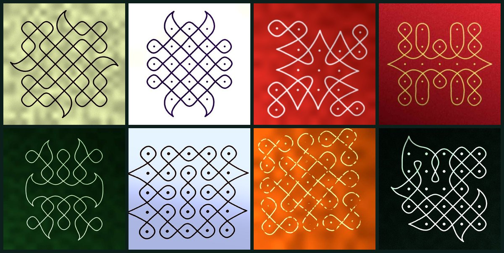
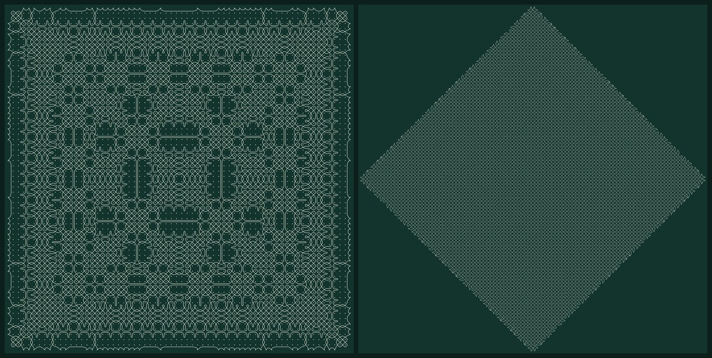
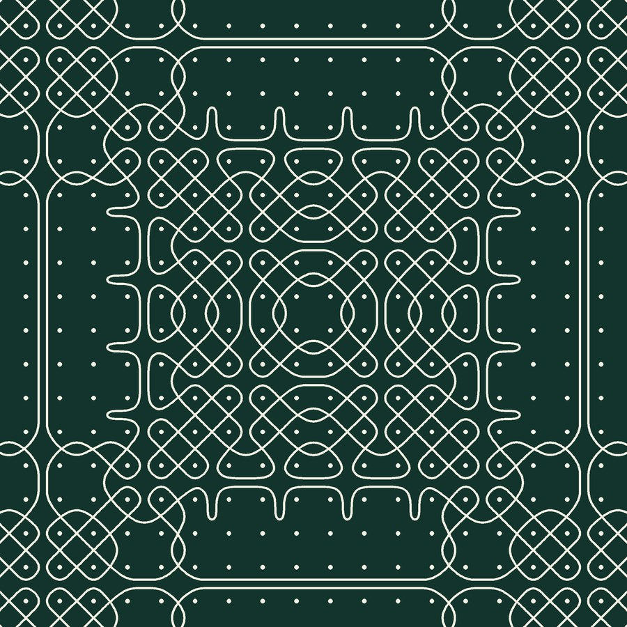
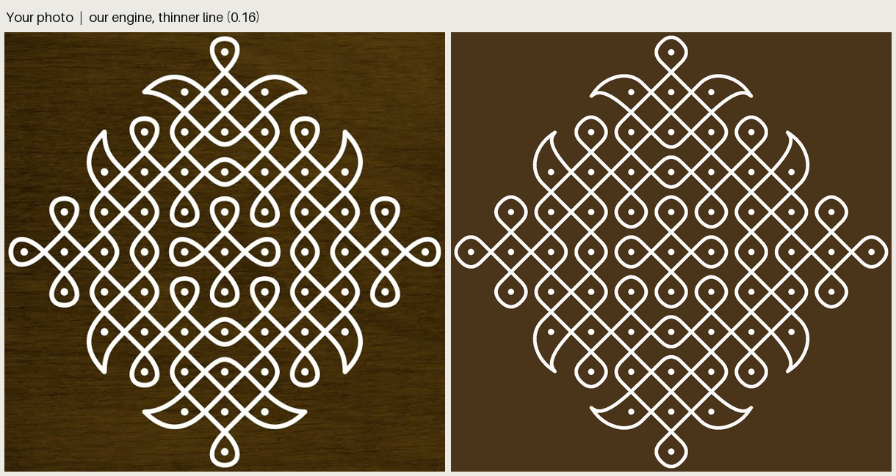
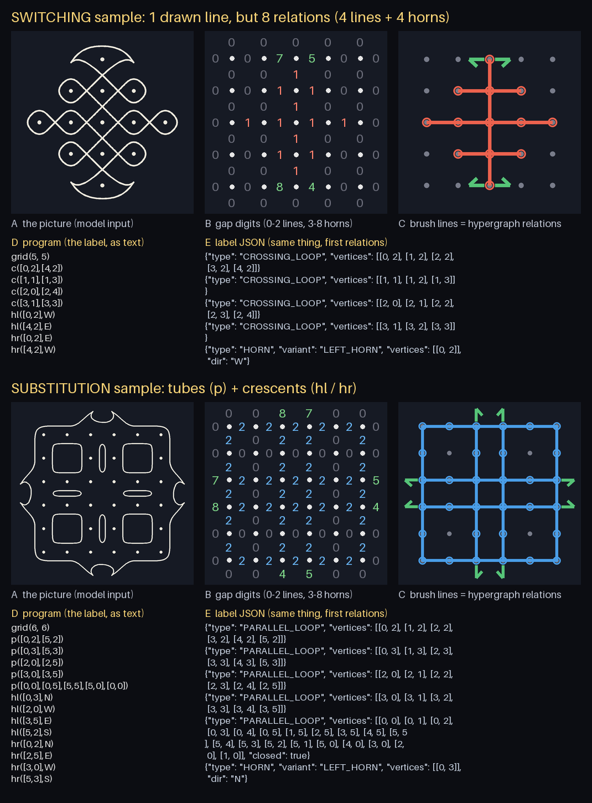
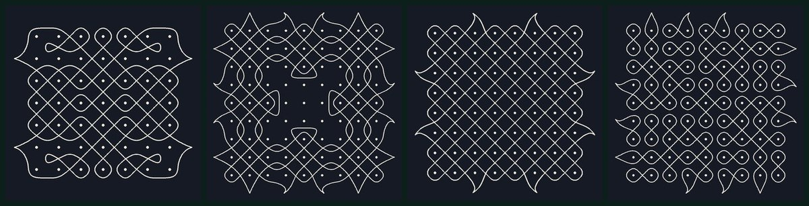
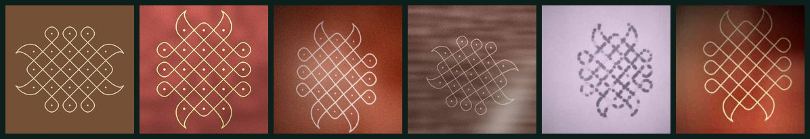

<div align="center">

# Kolam Core

**An AI that reads a kolam from a photo and draws it back, entirely in your browser.**

## 👉 [**Try it live → techonebytwo.com/siv4kumaru/kolam_labs**](https://techonebytwo.com/siv4kumaru/kolam_labs/index.html) 👈

[](https://techonebytwo.com/siv4kumaru/kolam_labs/index.html)


</div>

---

## Kolams it reads

Kolams the model never saw while training, read back exactly:



## Kolams it makes

Every kolam here was generated by Kolam Core from the rules of kolam drawing. These two have 64 × 64
and 100 × 100 dots:



<div align="center"><br>
<sub>a close look at the 64 × 64 one</sub></div>

## A real kolam, redrawn



## A kolam is a grid of digits

Between every two neighbouring dots there is a gap. Each gap gets one digit: **0** wall · **1** cross ·
**2** tube · **3–8** a petal horn. Write them down row by row and you have the whole kolam; follow
the line through them and it draws itself back. Exactly, both ways.

<table><tr>
<td width="55%"></td>
<td><br>
<sub>this one uses every digit, 0 to 8</sub></td>
</tr></table>



## Millions of kolams to learn from

Four programs grow kolams from the rules, and every one is checked before it is kept: around
**two million** so far, from 3 × 3 up to 20 × 20 dots.




Then each is drawn as if photographed: chalk, rice flour, cement, red oxide, a tilted camera, glare.
The digits never change, only the look.




## The model

A **ResNet** looks at the photo; a **transformer decoder** writes the digits one by one, and the
kolam rules let through only digits that still make a real kolam. It is converted to ONNX and runs
on WebAssembly in a background thread, so **everything happens inside your browser**: the photo
never leaves your device.

<div align="center">

### [**▶ Try it on a kolam**](https://techonebytwo.com/siv4kumaru/kolam_labs/index.html) · [How it works](https://techonebytwo.com/siv4kumaru/kolam_labs/how.html)

</div>

---

<details>
<summary><b>For developers: generating, checking, training, building the site</b></summary>

```text
kolam_gen (Rust)                               kolam_feed (Python)
generators → gaps + horns → checks → encoding  →  encoding → hypergraph → strokes → image  →  model
four systems    (exact label)   (§8, §10)   shards   (§12)                    a new look each epoch
```

Every image is drawn from its label, so every label is exact. Only encodings are stored; images are
rendered while training. The semantics are in `docs/hypergraph_kolams.md`; the training plan in `todo.md`.

```bash
pip install -r requirements.txt                       # numpy, pillow, pytest
cd kolam_gen && cargo build --release && cd ..
kolam_gen/target/release/kolam_gen generate -n 1000000 -o data/enc_1m   # ~1,000–2,000 kolams/s
python -m kolam_feed verify  data/enc_1m --n 5000     # independent Python re-check, exit 1 on failure
python -m kolam_feed preview data/enc_1m -o sheet.png
python -m kolam_feed train data/enc_1m --model grid --size 384 --aug real \
    --not-kolam data/not_kolam --real-kolams data/real_kolams_line --out runs/b --resume
python -m kolam_feed.watch runs/b                     # live training page
python -m kolam_feed export runs/b/best.pt && (cd kolam_studio && npm run build)   # dist/ = the site
python scripts/readme_gif.py data/enc_1m 66 docs/readme/drawing.gif                 # a kolam drawing itself
```

### The three brushes

| brush | call | what it draws |
|---|---|---|
| `CROSSING_LOOP` | `c([0,0],[0,4])` | a chain of dots; the line **crosses** (✕) in every gap along the chain |
| `PARALLEL_LOOP` | `p([2,0],[2,2],[4,2])` | a chain of dots; the strands run **parallel** around them, with no crossings |
| `HORN` | `h([1,1],N)` · `hl(…,N)` · `hr(…,N)` | a sharp tip grown out of dot `[1,1]`'s line, pointing N/E/S/W: straight / curving a little left / right; drawn as a crescent; up to 4 horns may meet in one spot |

Each brush only sets the state of the gaps between neighbouring dots (`CROSS`, `JOIN` or `SPLIT`);
the curve is traced from gate to gate (the Gerdes / Nagata mirror-curve model); a horn sets no gap.
Draw them by hand in the studio (`cd kolam_studio && npm run dev`, then `studio.html`).


### Generating data: `kolam_gen` (Rust)

Four systems, mixed (default `--mix random=0.55,substitution=0.15,switching=0.15,wfc=0.15`):
**random** (strokes with symmetric copies, often grown as a tree), **substitution** (every dot becomes
a block of dots, generation after generation), **switching** (all crossings, flipped only to merge
lines into one), **WFC** (pieces of a real kolam fitted together like a jigsaw). Every kolam passes the
label rules (§8.4) and the geometry check (curves ≥ 0.4 from every drawn dot, strands ≥ 0.2 apart
except at crossings, exactly one ✕ per crossing gap, the only corners are horn tips).

Output: `shard_00000.jsonl`, … (50k kolams each) and `manifest.json`. Each line: `id`, `system`,
`symmetry`, `seed` (every kolam is reproducible), `rows`, `cols`, `encoding`, `strokes`, `crossings`,
`horns`. Duplicates are redrawn; a stopped run resumes. `kolam_gen big --system substitution --size 100`
makes one kolam of any size.

### The training target: the kolam encoding

One digit per gap (`0` wall, `1` cross, `2` tube, `3`–`8` horns: plain / left / right, facing
right-or-down or left-or-up), rows of `cols` and `cols + 1` digits alternating. It converts to and
from the hypergraph exactly. Why this form and how lines are read back: spec §12 and `refs/grid_why.png`.

### Feeding and training: `kolam_feed` (Python)

- `KolamDataset` renders each kolam on the fly in a new look every epoch (style, turn, camera, floor,
  ink, glare); `NotKolamDataset` gives photos and drawn non-kolams for the is-it-a-kolam head
  (the photos are only ever non-kolam examples, never a kolam's background).
- Two models (`model.py`): A writes the digits one by one under constrained decoding; B finds the
  dot grid and reads every gap at once. B is the one going forward (`todo.md`).
- `verify` re-checks kolam_gen's output independently; Rust and Python give the same answers on the
  180 reference kolams in `tests/fixtures/kolams.jsonl`.

### Layout

```text
brushes.json   shared brush spec (gate states, horn shapes): read by kolam_gen, kolam_feed, kolam_studio
kolam_gen/     Rust: the four generator systems, compiler, drawing, geometry check → encoding shards
kolam_feed/    Python: encodings → images on the fly → the models; train, eval, export, live page; verify
kolam_studio/  the site (Vite + TS): index.html reader, how.html, studio.html drawing UI, encodings.html
scripts/       gpu/ overnight training on a GPU laptop; readme_gif.py
tests/         pytest: kolam encoding, kolam_feed, Rust ↔ Python agreement
docs/          hypergraph_kolams.md (spec) · references.md · results/ · readme/ (these pictures)
archive/       old TypeScript engine/UI — archived, not used
```

</details>
