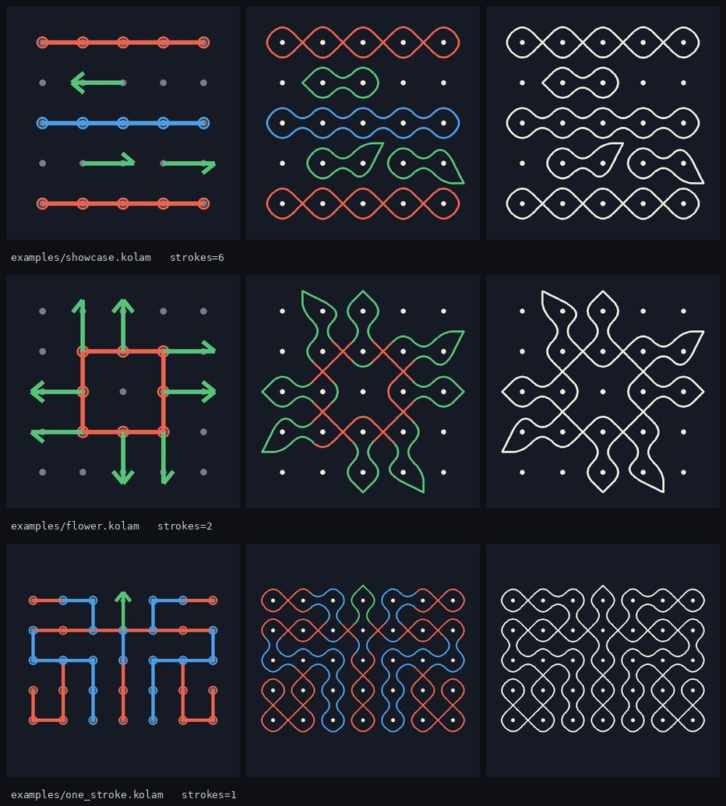
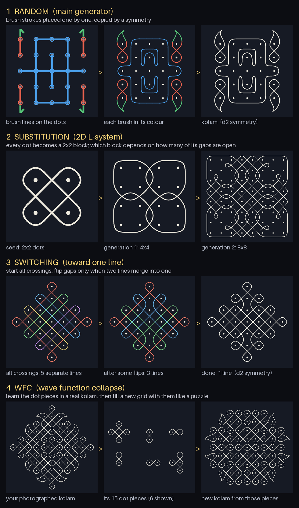
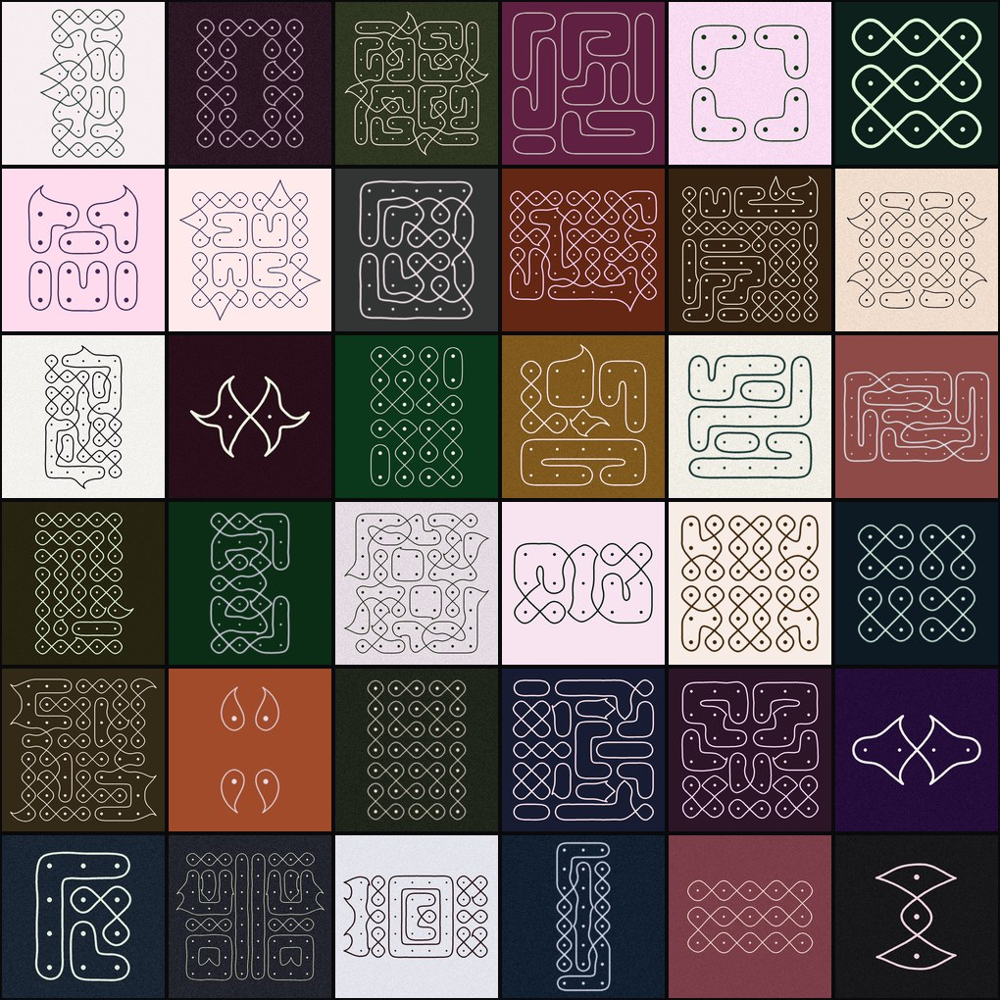
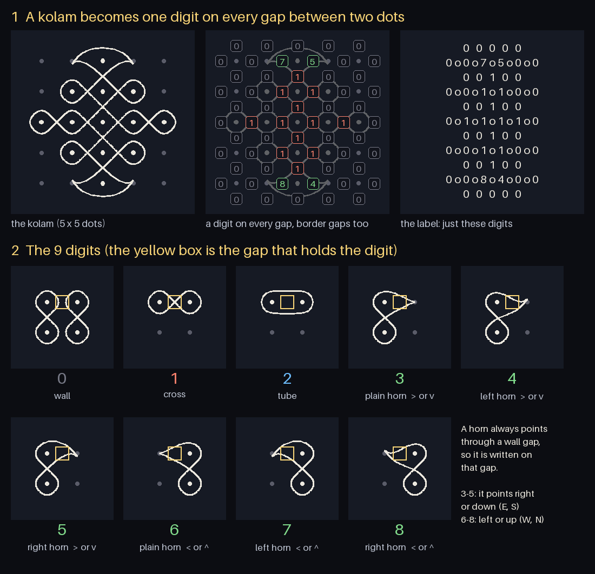

# Kolam Labs

**Goal:** build a dataset of kolam images, then train a model that reads a kolam image and
outputs its structure as an **ordered typed hypergraph** (`docs/hypergraph_kolams.md`).

```text
kolam_gen (Rust)                               kolam_feed (Python)
generators → gaps + horns → checks → encoding  →  encoding → hypergraph → strokes → image  →  model
four systems    (exact label)   (§8, §10)   shards   (§12)                    a new look each epoch
```

Every image is drawn from its label, so every label is exact. Only encodings are stored; images
are rendered while training.

```bash
pip install -r requirements.txt                       # numpy, pillow, pytest
cd kolam_gen && cargo build --release && cd ..
kolam_gen/target/release/kolam_gen generate -n 1000000 -o data/enc_1m   # ~1,300–2,100 kolams/s on 8 cores
python -m kolam_feed verify  data/enc_1m --n 5000     # independent Python re-check, exit 1 on failure
python -m kolam_feed preview data/enc_1m -o sheet.png
```

## The three brushes

A kolam is drawn with three brushes through the dots of a grid (`[row, col]`, 0-indexed):

| brush | call | what it draws |
|---|---|---|
| `CROSSING_LOOP` | `c([0,0],[0,4])` | a chain of dots; the line **crosses** (✕) in every gap along the chain |
| `PARALLEL_LOOP` | `p([2,0],[2,2],[4,2])` | a chain of dots; the strands run **parallel** around them, with no crossings |
| `HORN` | `h([1,1],N)` · `hl(…,N)` · `hr(…,N)` | a sharp tip grown out of dot `[1,1]`'s line, pointing N/E/S/W: straight / curving a little left / right. It points at an empty spot or off the grid and is drawn as a crescent; up to 4 horns may meet in one spot |

Draw them by hand in the studio (`cd kolam_studio && npm run dev`): drag across dots, read the
program, see the kolam. Its **encodings** tab renders pasted kolam encodings.



How it works, from hypergraph doc §8:
- Each brush only sets the state of the gaps between neighbouring dots: `CROSS`, `JOIN` or `SPLIT`.
- The curve is traced from gate to gate (the Gerdes / Nagata mirror-curve model).
- A horn sets no gap: the drawing grows the line in front of its dot into a sharp tip (§10.6).

A crossing brush along a row reproduces the notebook's `build_crossing_loop(n)` exactly.

## Generating data: `kolam_gen` (Rust)

Four systems, mixed (default `--mix random=0.55,substitution=0.15,switching=0.15,wfc=0.15`). All four
only choose what each gap between two dots does (wall, cross or tube), then add crescent horns.



- **Random** (the painter): a grid (3–8 dots a side) and a symmetry; brush strokes laid one at a time
  with their symmetric copies, a stroke that breaks a rule thrown out; about 40% grow as a tree
  (one-stroke kolams); leftover dots covered by longer chains or horns.
- **Substitution** (the fractal grower, a 2D L-system): every dot becomes a block of dots by a rule
  book made up for each kolam, generation after generation, so patterns sit inside patterns.
- **Switching** (the one-line maker): starts with every gap a crossing and flips gaps only when two
  lines merge into one, the way real sikku kolams are drawn as one unbroken line.
- **WFC** (the student): cuts a real kolam into dot pieces and fills a new grid with them like a jigsaw.

Every kolam passes the label rules (§8.4) and the geometry check before it is written:
- curves stay ≥ 0.4 from every drawn dot;
- strands stay ≥ 0.2 apart except at their crossings (dots are 2 apart);
- every crossing gap shows exactly one ✕;
- the only corners are horn tips.

Output: `shard_00000.jsonl`, … (50k kolams each, ~290 bytes per kolam) and `manifest.json` (counts,
redraws and drops per system). Each line: `id`, `system`, `symmetry`, `seed` (seed, index, attempt:
every kolam is reproducible), `rows`, `cols`, `encoding`, `strokes`, `crossings`, `horns`.
- Duplicates (the same encoding) are drawn again in the same system; after 50 tries the slot is
  dropped, never kept. A stopped run resumes: finished shards are kept.
- `kolam_gen big --system substitution --size 100 -o big.jsonl` makes one kolam of any size (beyond the
  dataset's 32 × 32 label limit); `kolam_gen check file.jsonl` prints geometry stats per encoding.



## The training target: the kolam encoding

Every kolam is one digit on each gap between two dots: `0` wall, `1` cross, `2` tube, `3`–`8` a horn
(plain / left / right, facing right-or-down or left-or-up). The label for training (`encoding`) is just
those digits as a grid, row by row, nothing else:

```text
00000
007500     ← two horns on the top dot
00100
001100
00100
011110     ← the long middle line
...
```

A model that predicts every gap at once outputs exactly this, at any grid size; a sequence model
writes it with 11 tokens (`0`–`8`, row end, end) under constrained decoding
(`kolam_feed.allowed_next`). It converts to and from the hypergraph exactly.



Why this form, how lines are read back, and tokenizer pitfalls: spec §12 and `refs/grid_why.png`.

## Feeding the model: `kolam_feed` (Python)

- `KolamDataset(dir, size=448, transform=None)` is a map-style dataset: item `i` is
  `{"image", "encoding", "text", "tokens", "system"}`, rendered in a random style (chalk, ink or
  colour; line width, dots, blur, noise, hand jitter) from (seed, epoch, i); `set_epoch(e)` before each
  epoch for new looks. Batch with `DataLoader(ds, collate_fn=kolam_feed.collate)` (lists, PIL images
  kept for a VLM processor), or pass a `transform` that makes tensors. About 17 images/s per process
  at 448 px.
- It holds the Python side of the kolam model: encoding ↔ canonical hypergraph, compiler, drawing,
  geometry check, decoding a drawing back to its label, renderer.
- `verify` re-checks kolam_gen's output independently: no duplicates and the right size on every
  line; a random sample checked in full (valid canonical label, geometry, decodes back from the
  drawing, encoding round trip, same stats).

Rust and Python agree: on 180 reference kolams saved from the first (Python) generator
(`tests/fixtures/kolams.jsonl`, 21 failing the geometry check), both give the same verdict and the same
stats, and every encoding reads back to the stored label. On 1,500 kolams sampled from a 100k Rust run,
the Python re-check found 0 failures.

## Earlier dataset (3000-sample run, `docs/results/report.md`)

Made by the first, Python generator, before the crescent-only horn rule (about half its horns are
short stubs) and before the kolam encoding. Every sample was re-checked from its label alone:
label valid and canonical, recompiles to the same strokes, geometry, decodes back from the drawing,
re-renders byte-identically, no two labels with the same picture — 0 failures in all.
3000 / 3000 unique labels, 2887 isomorphism classes (§6), 28% single-stroke.

**Labels are readable from pixels** (measured on that run). A one-off tiny MLP probe reading a 9×9
grid of ink samples around each gap (trained on 1050 images, tested on 450; grid position given) gets
99.87% of gaps right, 99.995% of horn-tip centres right, and the whole hypergraph exact on 92.9% of
kolams. Its misses are small rounded-versus-pointed differences that a real CNN should resolve.

## Layout

```text
brushes.json   shared brush spec (gate states, horn shapes): read by kolam_gen, kolam_feed, kolam_studio
kolam_gen/     Rust: the four generator systems, compiler, drawing, geometry check → encoding shards
kolam_feed/    Python: encodings → hypergraph → strokes → images on the fly → the model; verify
kolam_studio/  brush drawing UI (Vite + TS); encodings page
tests/         pytest: kolam encoding, kolam_feed, Rust ↔ Python agreement (fixtures/kolams.jsonl)
docs/          hypergraph_kolams.md (spec) · references.md · results/
archive/       old TypeScript engine/UI — archived, not used
```

## Next

- Train the image → hypergraph model with the kolam encoding (spec §12) as the target.
- Run a VLM baseline against the same checks.
